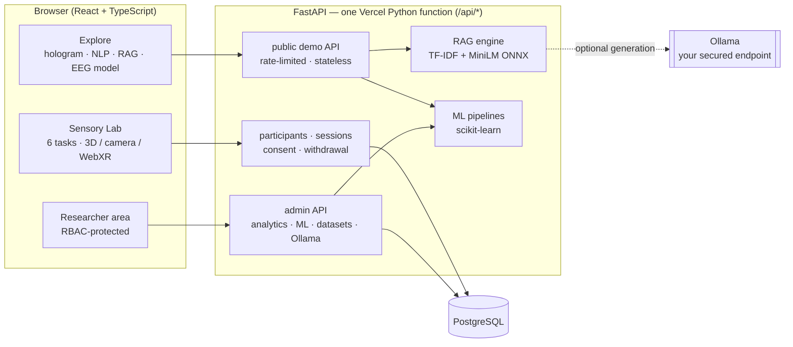

<div align="center">

# 🔺 PRISM

### Predictive Research through Interactive Sensory Mapping

**Understand the signals. Explore the patterns. Ground the insight in evidence.**

*A multimodal cognitive-research platform: a real-time 3D / camera / WebXR sensory lab, a leakage-safe ML pipeline on real physiological data, and a source-grounded NLP + RAG laboratory — one codebase, one deployment.*

`React · TypeScript · Three.js · WebXR` &nbsp;|&nbsp; `FastAPI · PostgreSQL · SQLAlchemy` &nbsp;|&nbsp; `scikit-learn · ONNX MiniLM · Ollama`

</div>

---

## ✨ What is PRISM?

PRISM studies how controlled sensory conditions relate to **attention, task performance, perceived workload and stress**, and asks a second question alongside it: *can NLP and retrieval-augmented generation connect people's own reflections to published evidence — transparently?*

It brings together:

| | Capability | What is actually inside |
|---|---|---|
| 🧪 | **Sensory Lab** | Six research tasks (visual search, auditory oddball, task switching, flanker, pattern recognition, arithmetic) with frame-accurate timestamps, NASA-TLX, pre/post stress and optional reflections |
| 🥽 | **Spatial environments** | Three.js 3D scene · live camera rendered *inside* the WebGL scene · WebXR `immersive-ar` with hit-test anchoring · 2D fallback, with capability detection and no silent substitution |
| 🧠 | **Predictive analytics** | Participant/subject-grouped nested evaluation, five candidate models (four families), baselines, PR/ROC-AUC, calibration, bootstrap CIs — on **real** PhysioNet EEG data |
| 🔎 | **NLP + RAG lab** | Lemmatisation, TF-IDF, RAKE keyphrases, VADER, NMF themes · hybrid TF-IDF + MiniLM retrieval · Ollama generation · citation, number and reference verification · an explicit *insufficient-evidence* state |
| 🔐 | **Research governance** | Argon2id auth, server-enforced RBAC, pseudonymous participants, versioned consent, withdrawal & deletion, audit log, an **ethics gate** that keeps data collection closed until an approval is recorded |
| 🌐 | **One deployment** | Static site + the whole API as a single Vercel Python function, PostgreSQL for persistence, ONNX instead of PyTorch |

> **Research integrity rule:** there is **no synthetic or simulated research data** anywhere in PRISM. Every figure is computed from consented PRISM sessions, a public dataset with verified provenance, or peer-reviewed literature — and a test fails the build if a generator ever returns.

---

## 🧭 How It Works



### The research loop

1. **Perceive** — tasks run in a controlled environment; each trial records stimulus onset (`performance.timeOrigin + paint timestamp`), the input event's own `timeStamp`, correctness, condition and display mode.
2. **Validate** — the server re-checks every session against the protocol (allowed tasks and trial types, RT ranges, timeout/RT consistency, trial counts, camera/display consistency) before it touches the database.
3. **Reflect** — NASA-TLX (raw), stress, perceived difficulty and an optional free-text reflection.
4. **Interpret** — descriptive and exploratory statistics with sample sizes on every chart; text analysis of reflections; retrieval over verified literature with citations you can open.
5. **Predict** — models are evaluated with participant-grouped splits; *no number is shown unless real data supports it* — otherwise the UI says **UNEVALUATED**.

### The RAG pipeline

| Stage | Implementation |
|---|---|
| Ingest | 26 abstracts + metadata from Europe PMC / arXiv (`scripts/fetch_corpus.py`); identifiers verified against API metadata |
| Chunk | 3-sentence windows, stride 2 → **102 passages** with character offsets back into the source |
| Index | TF-IDF (sublinear tf, light stemmer) **+** `all-MiniLM-L6-v2` (int8 ONNX via `onnxruntime`, no PyTorch); FAISS `IndexFlatIP` locally, exact NumPy search in production (identical results at this size) |
| Retrieve | Reciprocal-rank fusion of lexical and semantic rankings |
| Gate | Insufficient-evidence check: term coverage in a single passage + semantic score; refuses to answer rather than guess |
| Generate | Ollama (`qwen2.5:3b`) with a numbered-passage prompt — or a **labelled extractive fallback** that quotes sentences verbatim |
| Verify | Every citation must exist, ≥ 50 % lexical support per sentence, no author-year/DOI outside the retrieved sources; numbers in LLM-written model explanations are string-matched against the stored evaluation |

The UI always states which path produced an answer: **GENERATED by Ollama**, **EXTRACTIVE FALLBACK**, or **INSUFFICIENT EVIDENCE**. It never labels a fallback as Ollama.

### The ML protocol

```
group hold-out (25 % of participants) ─► TRAIN / TEST
TRAIN ─► GroupKFold CV ─► model selection (PR-AUC)      ← test rows never seen
final model ─► evaluated ONCE on TEST
         ├─ baselines: majority class, class prior
         ├─ ROC-AUC · PR-AUC · precision / recall / F1 · confusion matrix
         ├─ calibration bins + Brier score
         ├─ permutation importance (test set)
         └─ participant-cluster bootstrap 95 % CIs
```

Candidates: logistic regression (L2/L1), RBF-SVM, random forest, gradient boosting. Imputation and scaling are fitted *inside* each fold, so there is no preprocessing leakage.

---

## 📊 Measured Results

**Public EEG model** — PhysioNet *EEG During Mental Arithmetic Tasks* (ODC-By 1.0, DOI `10.13026/C2JQ1P`): 36 subjects · 72 recordings (all 72 SHA-256 checksums verified) · 432 ten-second epochs · rest vs mental arithmetic · subject-grouped split (27 train / 9 test subjects).

| Metric (held-out) | Logistic regression (selected by CV) |
|---|---|
| ROC-AUC | **0.700** (95 % CI 0.535 – 0.859) |
| PR-AUC / Brier | 0.735 / 0.255 |
| F1 / precision / recall | 0.701 / 0.651 / 0.759 |
| Majority baseline | F1 0.000 · accuracy 0.500 |

Modest, above-chance, wide uncertainty: one split, nine test subjects. The label is an experimental condition (rest always precedes the task), not a self-report — see the limitations in [`docs/DATASETS.md`](docs/DATASETS.md).

**Behavioural model (PRISM's own data):** requires ≥ 60 completed sessions from ≥ 20 participants with ≥ 15 per class. Below that the pipeline returns **UNEVALUATED — INSUFFICIENT REAL DATA** and reports no performance at all. Current status: unevaluated (no study data yet).

**Retrieval** (25 judged queries, document-level, single annotator → optimistic):

| Method | P@1 | P@3 | R@3 | R@5 | MRR |
|---|---|---|---|---|---|
| TF-IDF | 0.92 | 0.427 | 0.873 | 0.900 | 0.94 |
| MiniLM (ONNX int8) | 0.92 | 0.493 | 0.973 | 0.987 | 0.96 |

Evidence gate: 25/25 answerable accepted, 12/12 off-topic rejected — thresholds were tuned after seeing these questions, so treat it as a smoke test, not a benchmark.

---

## 🧱 Architecture & Design Decisions

| Decision | Why |
|---|---|
| **One Vercel project**, API as a single Python function (`api/index.py`) | A split frontend/backend deploy leaves a UI with no API. Vercel's Python limit is 500 MB; the production dependency set is ≈ 420 MB measured on Linux wheels |
| **ONNX Runtime instead of PyTorch** for MiniLM | PyTorch cannot fit; the 23 MB int8 model gives MRR 0.96 on the evaluation set |
| **FAISS only outside production** | 68 MB for 102 vectors; exact NumPy search returns identical rankings |
| **Precomputed EEG band-power features** packaged (99 KB) | The 175 MB raw archive cannot ship to serverless; features are derived from the real files, checksummed at ingestion |
| **PostgreSQL + Alembic** (SQLite for local dev) | Persistent research records, advisory-locked migrations safe for serverless cold starts, `NullPool` on Vercel |
| **Camera frames drawn inside WebGL** (`VideoTexture`) | Overlays composite in one depth-aware scene instead of CSS over a `<video>`; tracks are stopped on Stop, navigation, tab hide and page hide |
| **Honest AR labelling** | *Camera mode* is an orientation-tracked overlay (3-DoF gyro) and says so; only the WebXR path claims spatial anchoring |
| **Ollama stays external** | It cannot run on Vercel. Remote endpoints must be `https` with a bearer token, loopback is the only default, and production never probes localhost |
| **Server-side authorisation everywhere** | Anonymous / participant / researcher / admin are enforced by FastAPI dependencies and tested by calling endpoints directly, not by hiding tabs |
| **Ethics gate in code** | Enrolment and session upload return 403 until an admin records an approval reference; the reference is stored with each consent |

Deeper detail: [`docs/ARCHITECTURE.md`](docs/ARCHITECTURE.md) · [`docs/DEPLOYMENT.md`](docs/DEPLOYMENT.md) · [`docs/DATASETS.md`](docs/DATASETS.md) · [`docs/DATA_DICTIONARY.md`](docs/DATA_DICTIONARY.md) · [`docs/TECHNICAL_REPORT.md`](docs/TECHNICAL_REPORT.md)

---

## 🔐 Roles & Privacy

| Role | Credential | Can reach |
|---|---|---|
| Visitor | none | Landing, About, Explore (public literature, public EEG results, stateless text analysis), demo Sensory Lab — *nothing is stored* |
| Participant | random secret in an httpOnly cookie (only its SHA-256 is stored) | Only their **own** sessions: view, export, delete, withdraw |
| Researcher | email + Argon2id password | Analytics, exports, NLP/RAG, ML runs, dataset view |
| Admin | as above | + ethics gate, retention, staff accounts, dataset ingestion, participant erasure, Ollama settings |

No name, email, IP, user-agent, camera frames or microphone audio are collected. Withdrawal deletes every session, trial and reflection; only a minimal consent record (code, version, text hash, ethics reference, timestamps) remains. Every export, deletion, login and configuration change is audit-logged. CSRF is blocked with a required `X-PRISM-Client` header + `SameSite=Lax` cookies; accounts lock for 15 minutes after five failed logins.

---

## 🛠️ Technology Stack

| Layer | Tools |
|---|---|
| **Frontend** | React 18, TypeScript, Vite (code-split routes), Three.js (lazy-loaded), WebXR Device API, hand-built SVG charts |
| **Backend** | Python 3.12, FastAPI, Pydantic v2, SQLAlchemy 2, Alembic, Argon2 |
| **Data** | PostgreSQL (Neon via Vercel) · SQLite for local development |
| **ML** | scikit-learn, SciPy, pyEDFlib (local ingestion only) |
| **NLP / RAG** | onnxruntime + tokenizers (MiniLM), FAISS (local), simplemma, VADER, NMF/TF-IDF, Ollama (`qwen2.5:3b`) |
| **Quality** | pytest · Vitest + Testing Library · Playwright (real Chrome, fake capture device) |

---

## 🚀 Quick Start

```bash
# Backend + site, one command (SQLite, serves the built frontend on :8000)
scripts/start_local.sh

# create the first administrator (hidden password prompt, 12+ chars)
.venv/bin/python -m backend.cli create-admin you@example.org

# optional: local generation
ollama pull qwen2.5:3b
```

Dev servers: `uvicorn backend.app:app --port 8000` and `cd frontend && npm run dev` (proxies `/api`). Environment variables: [`.env.example`](.env.example).

**Deploy as one Vercel project** (site + API + Neon Postgres, ≈ 10 minutes): [`docs/DEPLOYMENT.md`](docs/DEPLOYMENT.md).

---

## 🔬 Testing

```bash
python -m pytest -q                       # 91 backend tests
PRISM_TEST_DATABASE_URL=postgresql://… python -m pytest -q   # same suite on PostgreSQL
cd frontend && npm test                   # 19 unit tests
cd frontend && npm run e2e                # 22 real-browser checks (Chrome + fake camera)
cd frontend && npm run e2e:research       # 10-step participation flow against the database
```

| Suite | Result when last run |
|---|---|
| Backend — auth/RBAC, participant isolation, validation, withdrawal, no-synthetic guards, ML gating & leakage, migrations, bootstrap admin, demo rate limits, production config, NLP, RAG, Ollama | 91 passed on SQLite · 91 on PostgreSQL 16 · all passing in a clean venv with only the production `requirements.txt` |
| Frontend unit — generators, camera permission / fallback / auto-stop, access gating, wording rules, chart rules | 19 passed |
| Browser E2E — 3D & camera pipeline, denial fallback, public NLP/RAG, EEG page, lab trials, API 401/403, admin pages, emulated iPhone / Pixel / iPad layouts | 22 / 22 |
| Participation flow — two participants enrol, save to PostgreSQL, isolation, dashboard, CSV, withdrawal | 10 / 10 |

Testing found and fixed real defects along the way (a blank screen after enrolment, a config-ordering bug that crashed default startup, a production fallback that falsely reported generation as ready).

---

## 🚧 Current Status & Honest Limits

PRISM is a research prototype for academic demonstration. **It is not a diagnostic tool and makes no clinical claims.**

- **Ethics:** no ethics approval is recorded, so participant data collection is closed by design; the Sensory Lab runs as an unsaved demo until an admin records a real approval.
- **Verified:** the full stack against PostgreSQL 16, the production dependency profile, and the exact Vercel entry module (`api/index.py`) in a clean-environment simulation.
- **Not yet verified:** an actual Vercel build and cold-start behaviour (deployment is in progress), Neon specifically, Python 3.12 on Vercel (tested on 3.9).
- **Camera:** exercised with Chrome's *synthetic* capture device — this proves the real getUserMedia → video → WebGL pipeline, stop/release and denial handling, **not** physical cameras or iOS Safari / Android Chrome.
- **WebXR:** implemented (hit-test reticle, tap-to-anchor) but **never run on a WebXR device**; it is disabled with an explanation wherever unsupported. Depth sensing is not implemented.
- **Mobile:** layout checks used Chromium emulation only.
- **Models:** the EEG model is one split on 36 subjects; the behavioural model awaits real participants; retrieval metrics are small and single-annotator.
- **Ollama in production** needs your own secured `https` endpoint; without it, answers are extractive and labelled as such.

---

## 🌟 Project Goal

To show how real-time sensory experiments, rigorously evaluated machine learning and transparent, evidence-grounded language tools can live in one honest system — where every number has a source, every answer can be inspected, and every limitation is stated on the page.

<div align="center">

**PRISM — Understand the signals. Explore the patterns. Ground the insight in evidence.**

</div>
